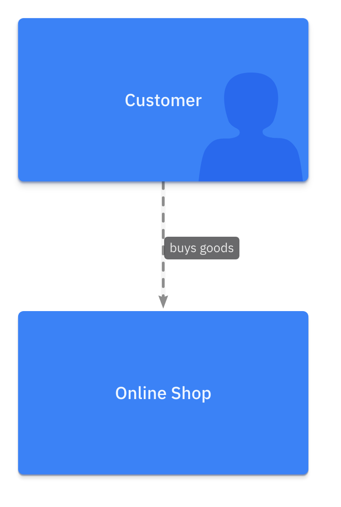
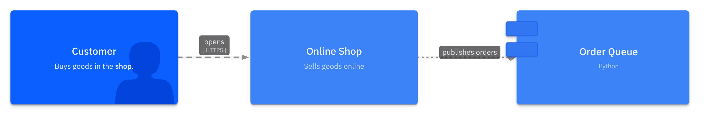

# LikeC4 Project Spec

> **Source:** [likec4.project.json](../../../assets/specs/likec4.project.json)


This schema describes the `Project` project spec for the LikeC4 backend.

## Properties

???+ info "Properties"

    <div class="code-nowrap"></div>

    | Field | Type | Description |
    |---|---|---|
    | `render_options` | <code><a href="#likec4renderoptionsschema">LikeC4RenderOptionsSchema</a></code> |  |
    | **`backend(required)`** | `string` | Required discriminator for the LikeC4 project JSON format. Must be exactly `likec4`. |
    | `deployment` | <code><a href="#likec4deploymentschema">LikeC4DeploymentSchema</a></code> |  |
    | `model` | <code><a href="#likec4modelschema">LikeC4ModelSchema</a></code> |  |
    | `name` | <span style="white-space: nowrap;">`string` \| `null`</span> | Optional project title. |
    | `specification` | <code><a href="#likec4specificationschema">LikeC4SpecificationSchema</a></code> |  |
    | `views` | <code><a href="#likec4viewsschema">LikeC4ViewsSchema</a></code> |  |

??? abstract "Examples"

    === "Minimal"

        ??? example "JSON source"

            ```json
            --8<-- "assets/examples/json/likec4/project.minimal.json"
            ```

        ??? example "Rendered LikeC4 DSL source"

            ```c4
            --8<-- "assets/examples/likec4/project.minimal.c4"
            ```

        ??? example "Rendered image"

            <figure markdown="span">
            
            </figure>


    === "Advanced"

        ??? example "JSON source"

            ```json
            --8<-- "assets/examples/json/likec4/project.advanced.json"
            ```

        ??? example "Rendered LikeC4 DSL source"

            ```c4
            --8<-- "assets/examples/likec4/project.advanced.c4"
            ```

        ??? example "Rendered image"

            <figure markdown="span">
            
            </figure>


## Definitions


### LikeC4AutoLayoutRuleSchema

``autoLayout direction [rank_sep [node_sep]]`` rule.

???+ info "Properties"

    <div class="code-nowrap"></div>

    | Field | Type | Description |
    |---|---|---|
    | `direction` | <code>enum[TopBottom \| LeftRight \| BottomTop \| RightLeft]</code> | Direction Default: `TopBottom`. |
    | `node_sep` | <span style="white-space: nowrap;">`integer` \| `null`</span> | Node Sep |
    | `rank_sep` | <span style="white-space: nowrap;">`integer` \| `null`</span> | Rank Sep |
    | **`rule(required)`** | `string` | Rule Must be exactly `auto_layout`. |
### LikeC4BetweenSchema

Relationship predicate ``source -> target`` (``<->`` with ``both``).

???+ info "Properties"

    <div class="code-nowrap"></div>

    | Field | Type | Description |
    |---|---|---|
    | **`type(required)`** | `string` | Type Must be exactly `between`. |
    | `both` | `boolean` | Both Default: `false`. |
    | **`source(required)`** | `object` | Source |
    | **`target(required)`** | `object` | Target |
### LikeC4ChildrenSchema

The direct children of an item (``item.*``).

???+ info "Properties"

    <div class="code-nowrap"></div>

    | Field | Type | Description |
    |---|---|---|
    | **`type(required)`** | `string` | Type Must be exactly `children`. |
    | **`of(required)`** | `string` | Of |
### LikeC4ColorSchema

A custom named color.

???+ info "Properties"

    <div class="code-nowrap"></div>

    | Field | Type | Description |
    |---|---|---|
    | **`name(required)`** | `string` | Name |
    | **`value(required)`** | `string` | Value |
### LikeC4DeploymentNodeSchema

A deployment node; nodes nest and hold instances.

???+ info "Properties"

    <div class="code-nowrap"></div>

    | Field | Type | Description |
    |---|---|---|
    | `title` | <span style="white-space: nowrap;">`string` \| `null`</span> | Title |
    | `alias` | <span style="white-space: nowrap;">`string` \| `null`</span> | Alias |
    | `description` | <span style="white-space: nowrap;">`string` \| `null`</span> | Description |
    | **`id(required)`** | `string` | Id |
    | `instances` | <code>array[<a href="#likec4instanceschema">LikeC4InstanceSchema</a>]</code> | Instances |
    | **`kind(required)`** | `string` | Kind |
    | `links` | <code>array[<a href="#likec4linkschema">LikeC4LinkSchema</a>]</code> | Links |
    | `metadata` | `object` | Metadata |
    | `nodes` | <code>array[<a href="#likec4deploymentnodeschema">LikeC4DeploymentNodeSchema</a>]</code> | Nodes |
    | `style` | `object` | Style |
    | `tags` | <code>array[string]</code> | Tags |
    | `technology` | <span style="white-space: nowrap;">`string` \| `null`</span> | Technology |
### LikeC4DeploymentRelationshipSchema

A relationship between deployment nodes or instances.

???+ info "Properties"

    <div class="code-nowrap"></div>

    | Field | Type | Description |
    |---|---|---|
    | `title` | <span style="white-space: nowrap;">`string` \| `null`</span> | Title |
    | `bidirectional` | `boolean` | Bidirectional Default: `false`. |
    | `description` | <span style="white-space: nowrap;">`string` \| `null`</span> | Description |
    | **`from(required)`** | `string` | From |
    | `kind` | <span style="white-space: nowrap;">`string` \| `null`</span> | Kind |
    | `links` | <code>array[<a href="#likec4linkschema">LikeC4LinkSchema</a>]</code> | Links |
    | `metadata` | `object` | Metadata |
    | `style` | `object` | Style |
    | `tags` | <code>array[string]</code> | Tags |
    | `technology` | <span style="white-space: nowrap;">`string` \| `null`</span> | Technology |
    | **`to(required)`** | `string` | To |
### LikeC4DeploymentSchema

The deployment nodes, instances and relationships of a project.

???+ info "Properties"

    <div class="code-nowrap"></div>

    | Field | Type | Description |
    |---|---|---|
    | `relationships` | <code>array[<a href="#likec4deploymentrelationshipschema">LikeC4DeploymentRelationshipSchema</a>]</code> | Relationships |
    | `nodes` | <code>array[<a href="#likec4deploymentnodeschema">LikeC4DeploymentNodeSchema</a>]</code> | Nodes |
### LikeC4DeploymentViewSchema

A view over deployment nodes and instances.

???+ info "Properties"

    <div class="code-nowrap"></div>

    | Field | Type | Description |
    |---|---|---|
    | **`type(required)`** | `string` | Type Must be exactly `deployment`. |
    | `title` | <span style="white-space: nowrap;">`string` \| `null`</span> | Title |
    | `description` | <span style="white-space: nowrap;">`string` \| `null`</span> | Description |
    | **`key(required)`** | `string` | Key |
    | `links` | <code>array[<a href="#likec4linkschema">LikeC4LinkSchema</a>]</code> | Links |
    | `rules` | <code>array[<br/>&nbsp;<code><a href="#likec4includeruleschema">LikeC4IncludeRuleSchema</a></code><br/>&nbsp;\|<code><a href="#likec4excluderuleschema">LikeC4ExcludeRuleSchema</a></code><br/>&nbsp;\|<code><a href="#likec4styleruleschema">LikeC4StyleRuleSchema</a></code><br/>&nbsp;\|<code><a href="#likec4autolayoutruleschema">LikeC4AutoLayoutRuleSchema</a></code><br/>]</code> | Rules |
    | `tags` | <code>array[string]</code> | Tags |
### LikeC4DescendantsSchema

All nested items of an item (``item.**``).

???+ info "Properties"

    <div class="code-nowrap"></div>

    | Field | Type | Description |
    |---|---|---|
    | **`type(required)`** | `string` | Type Must be exactly `descendants`. |
    | **`of(required)`** | `string` | Of |
### LikeC4DynamicStepSchema

One flat interaction of a dynamic view; blocks are not supported.

???+ info "Properties"

    <div class="code-nowrap"></div>

    | Field | Type | Description |
    |---|---|---|
    | `title` | <span style="white-space: nowrap;">`string` \| `null`</span> | Title |
    | `backward` | `boolean` | Backward Default: `false`. |
    | `color` | <span style="white-space: nowrap;">`string` \| `null`</span> | Color |
    | `description` | <span style="white-space: nowrap;">`string` \| `null`</span> | Description |
    | **`from(required)`** | `string` | From |
    | `navigate_to` | <span style="white-space: nowrap;">`string` \| `null`</span> | Navigate To |
    | `notes` | <span style="white-space: nowrap;">`string` \| `null`</span> | Notes |
    | `technology` | <span style="white-space: nowrap;">`string` \| `null`</span> | Technology |
    | **`to(required)`** | `string` | To |
### LikeC4DynamicViewSchema

A dynamic view: an ordered, flat list of steps.

???+ info "Properties"

    <div class="code-nowrap"></div>

    | Field | Type | Description |
    |---|---|---|
    | **`type(required)`** | `string` | Type Must be exactly `dynamic`. |
    | `title` | <span style="white-space: nowrap;">`string` \| `null`</span> | Title |
    | `description` | <span style="white-space: nowrap;">`string` \| `null`</span> | Description |
    | **`key(required)`** | `string` | Key |
    | `links` | <code>array[<a href="#likec4linkschema">LikeC4LinkSchema</a>]</code> | Links |
    | `steps` | <code>array[<a href="#likec4dynamicstepschema">LikeC4DynamicStepSchema</a>]</code> | Steps |
    | `tags` | <code>array[string]</code> | Tags |
    | `variant` | <code>enum[diagram \| sequence]</code> | Variant Default: `diagram`. |
### LikeC4ElementKindSchema

A declared element or deployment node kind.

???+ info "Properties"

    <div class="code-nowrap"></div>

    | Field | Type | Description |
    |---|---|---|
    | `title` | <span style="white-space: nowrap;">`string` \| `null`</span> | Title |
    | `description` | <span style="white-space: nowrap;">`string` \| `null`</span> | Description |
    | **`name(required)`** | `string` | Name |
    | `notation` | <span style="white-space: nowrap;">`string` \| `null`</span> | Notation |
    | `style` | `object` | Style |
    | `tags` | <code>array[string]</code> | Tags |
    | `technology` | <span style="white-space: nowrap;">`string` \| `null`</span> | Technology |
### LikeC4ElementRefSchema

A reference to a model element, node or instance by id.

???+ info "Properties"

    <div class="code-nowrap"></div>

    | Field | Type | Description |
    |---|---|---|
    | **`type(required)`** | `string` | Type Must be exactly `element`. |
    | **`id(required)`** | `string` | Id |
### LikeC4ElementSchema

A model element; children nest without limit.

???+ info "Properties"

    <div class="code-nowrap"></div>

    | Field | Type | Description |
    |---|---|---|
    | `title` | <span style="white-space: nowrap;">`string` \| `null`</span> | Title |
    | `elements` | <code>array[<a href="#likec4elementschema">LikeC4ElementSchema</a>]</code> | Elements |
    | `alias` | <span style="white-space: nowrap;">`string` \| `null`</span> | Alias |
    | `description` | <span style="white-space: nowrap;">`string` \| `null`</span> | Description |
    | `icon` | <span style="white-space: nowrap;">`string` \| `null`</span> | Icon |
    | **`id(required)`** | `string` | Id |
    | **`kind(required)`** | `string` | Kind |
    | `links` | <code>array[<a href="#likec4linkschema">LikeC4LinkSchema</a>]</code> | Links |
    | `metadata` | `object` | Metadata |
    | `style` | `object` | Style |
    | `summary` | <span style="white-space: nowrap;">`string` \| `null`</span> | Summary |
    | `tags` | <code>array[string]</code> | Tags |
    | `technology` | <span style="white-space: nowrap;">`string` \| `null`</span> | Technology |
### LikeC4ElementViewSchema

A view over model elements.

???+ info "Properties"

    <div class="code-nowrap"></div>

    | Field | Type | Description |
    |---|---|---|
    | **`type(required)`** | `string` | Type Must be exactly `element`. |
    | `title` | <span style="white-space: nowrap;">`string` \| `null`</span> | Title |
    | `description` | <span style="white-space: nowrap;">`string` \| `null`</span> | Description |
    | **`key(required)`** | `string` | Key |
    | `links` | <code>array[<a href="#likec4linkschema">LikeC4LinkSchema</a>]</code> | Links |
    | `of` | <span style="white-space: nowrap;">`string` \| `null`</span> | Of |
    | `rules` | <code>array[<br/>&nbsp;<code><a href="#likec4includeruleschema">LikeC4IncludeRuleSchema</a></code><br/>&nbsp;\|<code><a href="#likec4excluderuleschema">LikeC4ExcludeRuleSchema</a></code><br/>&nbsp;\|<code><a href="#likec4styleruleschema">LikeC4StyleRuleSchema</a></code><br/>&nbsp;\|<code><a href="#likec4autolayoutruleschema">LikeC4AutoLayoutRuleSchema</a></code><br/>]</code> | Rules |
    | `tags` | <code>array[string]</code> | Tags |
### LikeC4ExcludeRuleSchema

``exclude items`` rule.

???+ info "Properties"

    <div class="code-nowrap"></div>

    | Field | Type | Description |
    |---|---|---|
    | **`items(required)`** | <code>array[<br/>&nbsp;<code><a href="#likec4wildcardschema">LikeC4WildcardSchema</a></code><br/>&nbsp;\|<code><a href="#likec4elementrefschema">LikeC4ElementRefSchema</a></code><br/>&nbsp;\|<code><a href="#likec4childrenschema">LikeC4ChildrenSchema</a></code><br/>&nbsp;\|<code><a href="#likec4descendantsschema">LikeC4DescendantsSchema</a></code><br/>&nbsp;\|<code><a href="#likec4whereschema">LikeC4WhereSchema</a></code><br/>&nbsp;\|<code><a href="#likec4betweenschema">LikeC4BetweenSchema</a></code><br/>&nbsp;\|<code><a href="#likec4incomingschema">LikeC4IncomingSchema</a></code><br/>&nbsp;\|<code><a href="#likec4outgoingschema">LikeC4OutgoingSchema</a></code><br/>&nbsp;\|<code><a href="#likec4inoutschema">LikeC4InOutSchema</a></code><br/>&nbsp;\|<code><a href="#likec4rawpredicateschema">LikeC4RawPredicateSchema</a></code><br/>]</code> | Items |
    | **`rule(required)`** | `string` | Rule Must be exactly `exclude`. |
### LikeC4InOutSchema

Relationship predicate ``-> item ->``.

???+ info "Properties"

    <div class="code-nowrap"></div>

    | Field | Type | Description |
    |---|---|---|
    | **`type(required)`** | `string` | Type Must be exactly `inout`. |
    | **`item(required)`** | `object` | Item |
### LikeC4IncludeRuleSchema

``include items [with { navigateTo key }]`` rule.

???+ info "Properties"

    <div class="code-nowrap"></div>

    | Field | Type | Description |
    |---|---|---|
    | **`items(required)`** | <code>array[<br/>&nbsp;<code><a href="#likec4wildcardschema">LikeC4WildcardSchema</a></code><br/>&nbsp;\|<code><a href="#likec4elementrefschema">LikeC4ElementRefSchema</a></code><br/>&nbsp;\|<code><a href="#likec4childrenschema">LikeC4ChildrenSchema</a></code><br/>&nbsp;\|<code><a href="#likec4descendantsschema">LikeC4DescendantsSchema</a></code><br/>&nbsp;\|<code><a href="#likec4whereschema">LikeC4WhereSchema</a></code><br/>&nbsp;\|<code><a href="#likec4betweenschema">LikeC4BetweenSchema</a></code><br/>&nbsp;\|<code><a href="#likec4incomingschema">LikeC4IncomingSchema</a></code><br/>&nbsp;\|<code><a href="#likec4outgoingschema">LikeC4OutgoingSchema</a></code><br/>&nbsp;\|<code><a href="#likec4inoutschema">LikeC4InOutSchema</a></code><br/>&nbsp;\|<code><a href="#likec4rawpredicateschema">LikeC4RawPredicateSchema</a></code><br/>]</code> | Items |
    | `navigate_to` | <span style="white-space: nowrap;">`string` \| `null`</span> | Navigate To |
    | **`rule(required)`** | `string` | Rule Must be exactly `include`. |
### LikeC4IncomingSchema

Relationship predicate ``-> item``.

???+ info "Properties"

    <div class="code-nowrap"></div>

    | Field | Type | Description |
    |---|---|---|
    | **`type(required)`** | `string` | Type Must be exactly `incoming`. |
    | **`item(required)`** | `object` | Item |
### LikeC4InstanceSchema

An instance of a model element deployed on a node.

???+ info "Properties"

    <div class="code-nowrap"></div>

    | Field | Type | Description |
    |---|---|---|
    | `title` | <span style="white-space: nowrap;">`string` \| `null`</span> | Title |
    | `description` | <span style="white-space: nowrap;">`string` \| `null`</span> | Description |
    | **`element(required)`** | `string` | Element |
    | `id` | <span style="white-space: nowrap;">`string` \| `null`</span> | Id |
    | `links` | <code>array[<a href="#likec4linkschema">LikeC4LinkSchema</a>]</code> | Links |
    | `metadata` | `object` | Metadata |
    | `name` | <span style="white-space: nowrap;">`string` \| `null`</span> | Name |
    | `style` | `object` | Style |
    | `tags` | <code>array[string]</code> | Tags |
    | `technology` | <span style="white-space: nowrap;">`string` \| `null`</span> | Technology |
### LikeC4LinkSchema

A hyperlink attached to an element, relationship or view.

???+ info "Properties"

    <div class="code-nowrap"></div>

    | Field | Type | Description |
    |---|---|---|
    | `title` | <span style="white-space: nowrap;">`string` \| `null`</span> | Title |
    | **`url(required)`** | `string` | Url |
### LikeC4ModelSchema

The element hierarchy and relationships of a project.

???+ info "Properties"

    <div class="code-nowrap"></div>

    | Field | Type | Description |
    |---|---|---|
    | `elements` | <code>array[<a href="#likec4elementschema">LikeC4ElementSchema</a>]</code> | Elements |
    | `relationships` | <code>array[<a href="#likec4relationshipschema">LikeC4RelationshipSchema</a>]</code> | Relationships |
### LikeC4OutgoingSchema

Relationship predicate ``item ->``.

???+ info "Properties"

    <div class="code-nowrap"></div>

    | Field | Type | Description |
    |---|---|---|
    | **`type(required)`** | `string` | Type Must be exactly `outgoing`. |
    | **`item(required)`** | `object` | Item |
### LikeC4RawPredicateSchema

Predicate text emitted verbatim.

???+ info "Properties"

    <div class="code-nowrap"></div>

    | Field | Type | Description |
    |---|---|---|
    | **`type(required)`** | `string` | Type Must be exactly `raw`. |
    | **`text(required)`** | `string` | Text |
### LikeC4RelationshipKindSchema

A declared relationship kind.

???+ info "Properties"

    <div class="code-nowrap"></div>

    | Field | Type | Description |
    |---|---|---|
    | `description` | <span style="white-space: nowrap;">`string` \| `null`</span> | Description |
    | **`name(required)`** | `string` | Name |
    | `style` | `object` | Style |
    | `technology` | <span style="white-space: nowrap;">`string` \| `null`</span> | Technology |
### LikeC4RelationshipSchema

A model relationship using c4-diagrams ``from``/``to`` spelling.

???+ info "Properties"

    <div class="code-nowrap"></div>

    | Field | Type | Description |
    |---|---|---|
    | `title` | <span style="white-space: nowrap;">`string` \| `null`</span> | Title |
    | `bidirectional` | `boolean` | Bidirectional Default: `false`. |
    | `description` | <span style="white-space: nowrap;">`string` \| `null`</span> | Description |
    | **`from(required)`** | `string` | From |
    | `kind` | <span style="white-space: nowrap;">`string` \| `null`</span> | Kind |
    | `links` | <code>array[<a href="#likec4linkschema">LikeC4LinkSchema</a>]</code> | Links |
    | `metadata` | `object` | Metadata |
    | `navigate_to` | <span style="white-space: nowrap;">`string` \| `null`</span> | Navigate To |
    | `style` | `object` | Style |
    | `tags` | <code>array[string]</code> | Tags |
    | `technology` | <span style="white-space: nowrap;">`string` \| `null`</span> | Technology |
    | **`to(required)`** | `string` | To |
### LikeC4RenderOptionsSchema

LikeC4 renderer options.

???+ info "Properties"

    <div class="code-nowrap"></div>

    | Field | Type | Description |
    |---|---|---|
    | `view_key` | <span style="white-space: nowrap;">`string` \| `null`</span> | View exported as an image when none is chosen otherwise. |
### LikeC4SpecificationSchema

The vocabulary of a project: kinds, tags and custom colors.

???+ info "Properties"

    <div class="code-nowrap"></div>

    | Field | Type | Description |
    |---|---|---|
    | `elements` | <code>array[<a href="#likec4elementkindschema">LikeC4ElementKindSchema</a>]</code> | Elements |
    | `relationships` | <code>array[<a href="#likec4relationshipkindschema">LikeC4RelationshipKindSchema</a>]</code> | Relationships |
    | `colors` | <code>array[<a href="#likec4colorschema">LikeC4ColorSchema</a>]</code> | Colors |
    | `deployment_nodes` | <code>array[<a href="#likec4elementkindschema">LikeC4ElementKindSchema</a>]</code> | Deployment Nodes |
    | `tags` | <code>array[<a href="#likec4tagschema">LikeC4TagSchema</a>]</code> | Tags |
### LikeC4StyleRuleSchema

``style targets { ... }`` rule.

???+ info "Properties"

    <div class="code-nowrap"></div>

    | Field | Type | Description |
    |---|---|---|
    | **`properties(required)`** | `object` | Properties |
    | **`rule(required)`** | `string` | Rule Must be exactly `style`. |
    | **`targets(required)`** | <code>array[<br/>&nbsp;<code><a href="#likec4wildcardschema">LikeC4WildcardSchema</a></code><br/>&nbsp;\|<code><a href="#likec4elementrefschema">LikeC4ElementRefSchema</a></code><br/>&nbsp;\|<code><a href="#likec4childrenschema">LikeC4ChildrenSchema</a></code><br/>&nbsp;\|<code><a href="#likec4descendantsschema">LikeC4DescendantsSchema</a></code><br/>&nbsp;\|<code><a href="#likec4whereschema">LikeC4WhereSchema</a></code><br/>&nbsp;\|<code><a href="#likec4betweenschema">LikeC4BetweenSchema</a></code><br/>&nbsp;\|<code><a href="#likec4incomingschema">LikeC4IncomingSchema</a></code><br/>&nbsp;\|<code><a href="#likec4outgoingschema">LikeC4OutgoingSchema</a></code><br/>&nbsp;\|<code><a href="#likec4inoutschema">LikeC4InOutSchema</a></code><br/>&nbsp;\|<code><a href="#likec4rawpredicateschema">LikeC4RawPredicateSchema</a></code><br/>]</code> | Targets |
### LikeC4TagSchema

A declared tag; the name is written without ``#``.

???+ info "Properties"

    <div class="code-nowrap"></div>

    | Field | Type | Description |
    |---|---|---|
    | `color` | <span style="white-space: nowrap;">`string` \| `null`</span> | Color |
    | **`name(required)`** | `string` | Name |
### LikeC4ViewsSchema

Declared views in authoring order.

???+ info "Properties"

    <div class="code-nowrap"></div>

    | Field | Type | Description |
    |---|---|---|
    | `items` | <code>array[<code><a href="#likec4elementviewschema">LikeC4ElementViewSchema</a></code>\|<code><a href="#likec4deploymentviewschema">LikeC4DeploymentViewSchema</a></code>\|<code><a href="#likec4dynamicviewschema">LikeC4DynamicViewSchema</a></code>]</code> | Items |
### LikeC4WhereSchema

``item where tag is #tag and kind is kind`` filter.

???+ info "Properties"

    <div class="code-nowrap"></div>

    | Field | Type | Description |
    |---|---|---|
    | **`type(required)`** | `string` | Type Must be exactly `where`. |
    | **`item(required)`** | `object` | Item |
    | `kind` | <span style="white-space: nowrap;">`string` \| `null`</span> | Kind |
    | `tag` | <span style="white-space: nowrap;">`string` \| `null`</span> | Tag |
### LikeC4WildcardSchema

The ``*`` predicate.

???+ info "Properties"

    <div class="code-nowrap"></div>

    | Field | Type | Description |
    |---|---|---|
    | **`type(required)`** | `string` | Type Must be exactly `wildcard`. |
