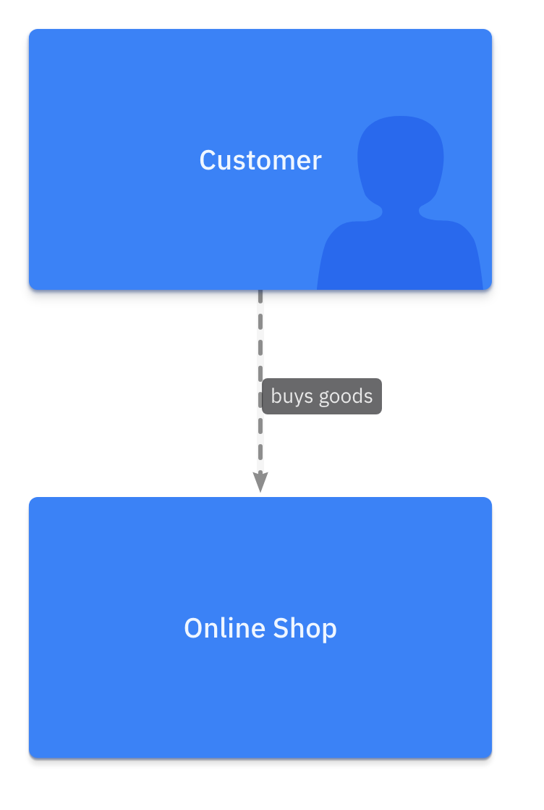
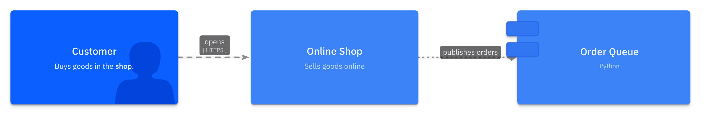
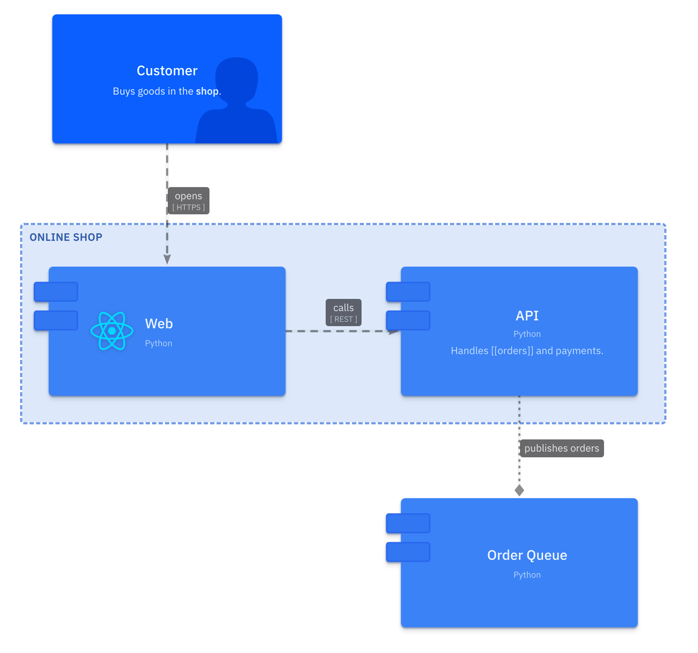
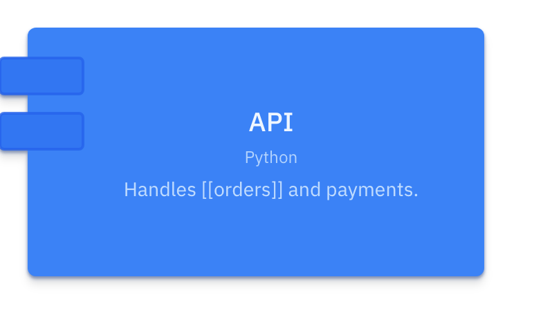
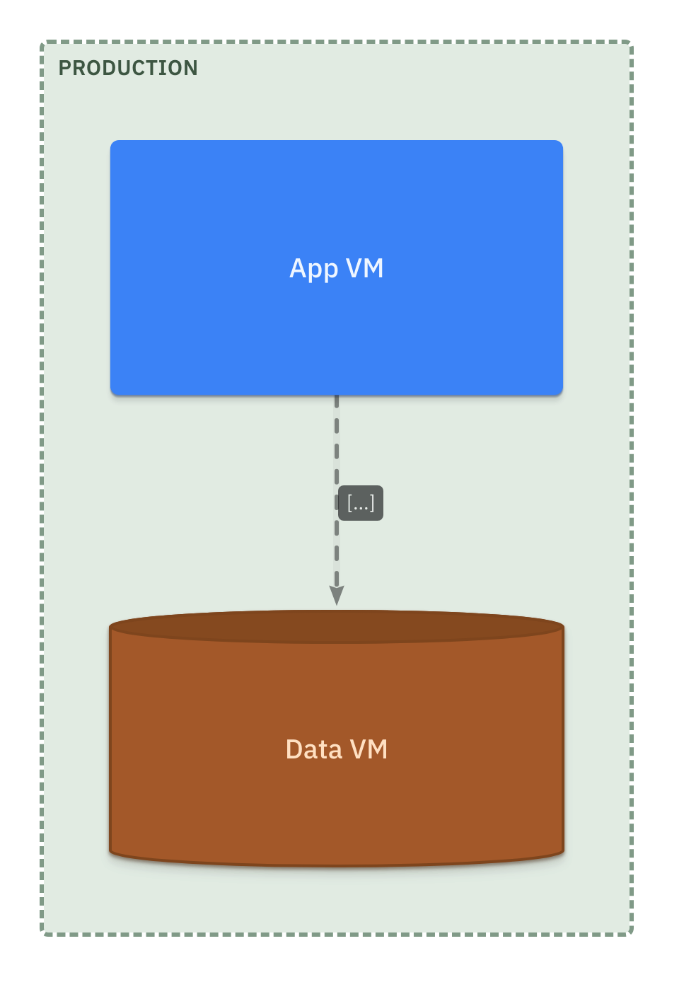
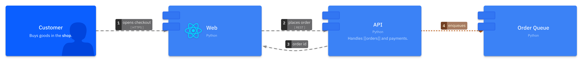

# LikeC4

LikeC4 examples describe a whole `Project` (specification, model, deployment and
views) instead of one portable diagram, so they are not part of the
[common examples](../index.md). Each example below is defined as JSON, converted
to Python with `c4 convert --json-to-py`, rendered to `.c4` with
`c4 render --likec4`, and exported with `c4 export --likec4` (a local `likec4`
CLI and Playwright Chromium are required for images, see
[installation](../../installation.md#likec4-requirements)). The
**Interactive** tabs embed the [LikeC4 web
component](https://likec4.dev/tooling/code-generation/webcomponent/) generated
by `likec4 codegen webcomponent`.

## Minimal project

One element kind pair, two elements, a relationship and a single view.

=== "Image"

    <figure markdown="span">
      
      <figcaption>project.minimal.png (view <code>index</code>)</figcaption>
    </figure>

=== "Interactive"

    <div class="likec4-embed" data-bundle="../../../assets/examples/likec4/project.minimal.viewer.js" data-prefix="likec4-minimal" data-view="index"></div>

    Click the diagram to open it in the LikeC4 viewer.

??? abstract "JSON project"

    ```json
    --8<-- "assets/examples/json/likec4/project.minimal.json"
    ```

??? abstract "Converted Python project"

    ```python
    --8<-- "assets/examples/likec4/project.minimal.py"
    ```

??? abstract "Rendered LikeC4 source"

    ```c4
    --8<-- "assets/examples/likec4/project.minimal.c4"
    ```

<br/>

## Advanced project

A specification with custom colors, kinds, tags and a relationship kind; nested
elements with metadata, links and icons; a deployment with instances; and five
views: a landscape, a scoped view with predicates, a raw predicate, a deployment
view and a sequence-style dynamic view.

=== "Landscape"

    === "Image"

        <figure markdown="span">
          
          <figcaption>index</figcaption>
        </figure>

    === "Interactive"

        <div class="likec4-embed" data-bundle="../../../assets/examples/likec4/project.advanced.viewer.js" data-prefix="likec4-advanced" data-view="index"></div>

=== "Scoped view"

    === "Image"

        <figure markdown="span">
          
          <figcaption>shop-detail</figcaption>
        </figure>

    === "Interactive"

        <div class="likec4-embed" data-bundle="../../../assets/examples/likec4/project.advanced.viewer.js" data-prefix="likec4-advanced" data-view="shop-detail"></div>

=== "Raw predicate"

    === "Image"

        <figure markdown="span">
          
          <figcaption>critical</figcaption>
        </figure>

    === "Interactive"

        <div class="likec4-embed" data-bundle="../../../assets/examples/likec4/project.advanced.viewer.js" data-prefix="likec4-advanced" data-view="critical"></div>

=== "Deployment"

    === "Image"

        <figure markdown="span">
          
          <figcaption>production</figcaption>
        </figure>

    === "Interactive"

        <div class="likec4-embed" data-bundle="../../../assets/examples/likec4/project.advanced.viewer.js" data-prefix="likec4-advanced" data-view="production"></div>

=== "Dynamic"

    === "Image"

        <figure markdown="span">
          
          <figcaption>checkout</figcaption>
        </figure>

    === "Interactive"

        <div class="likec4-embed" data-bundle="../../../assets/examples/likec4/project.advanced.viewer.js" data-prefix="likec4-advanced" data-view="checkout"></div>

??? abstract "JSON project"

    ```json
    --8<-- "assets/examples/json/likec4/project.advanced.json"
    ```

??? abstract "Converted Python project"

    ```python
    --8<-- "assets/examples/likec4/project.advanced.py"
    ```

??? abstract "Rendered LikeC4 source"

    ```c4
    --8<-- "assets/examples/likec4/project.advanced.c4"
    ```
