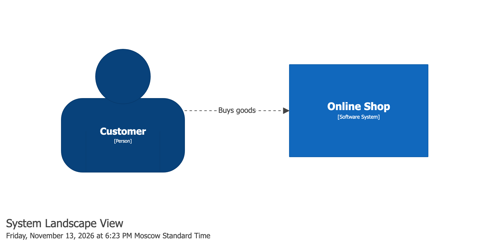
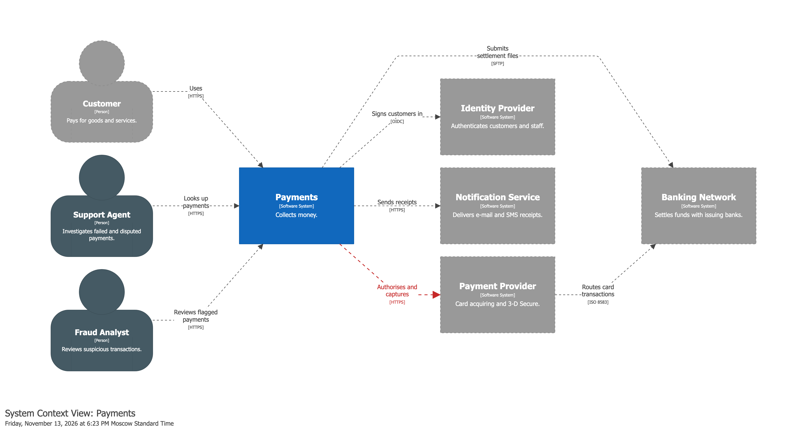
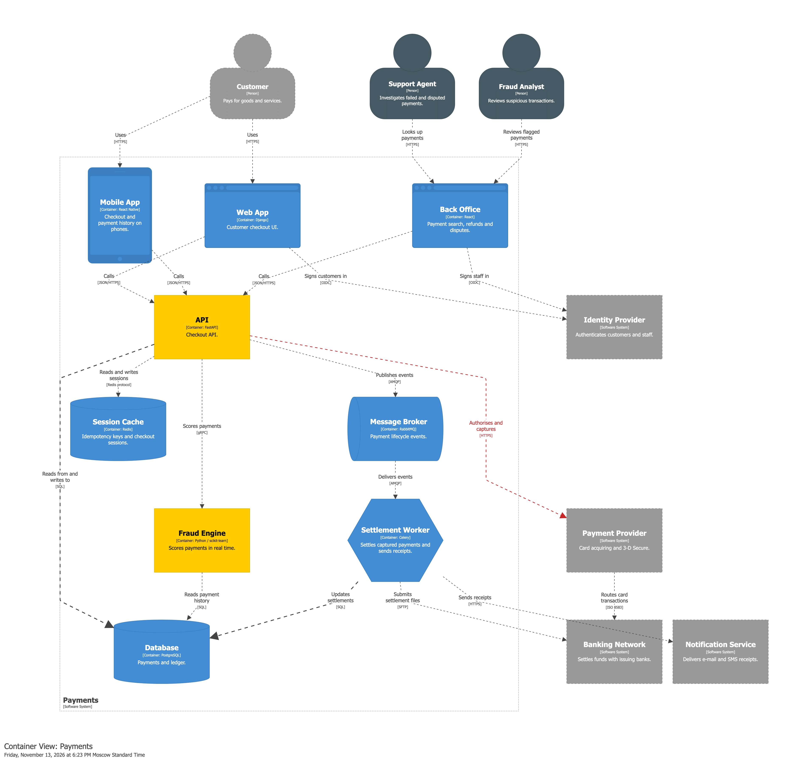
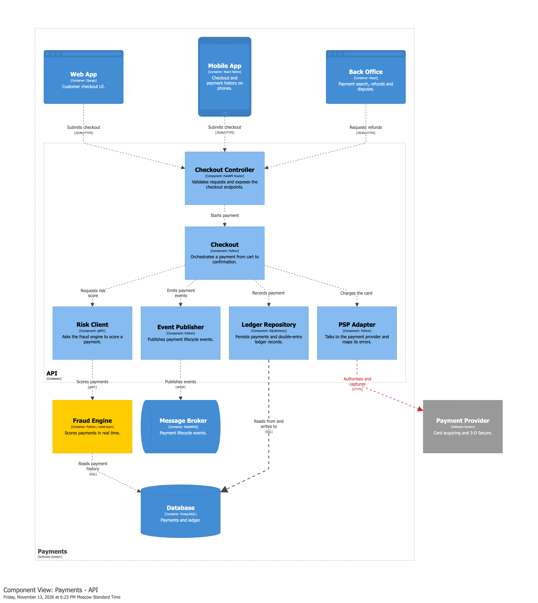
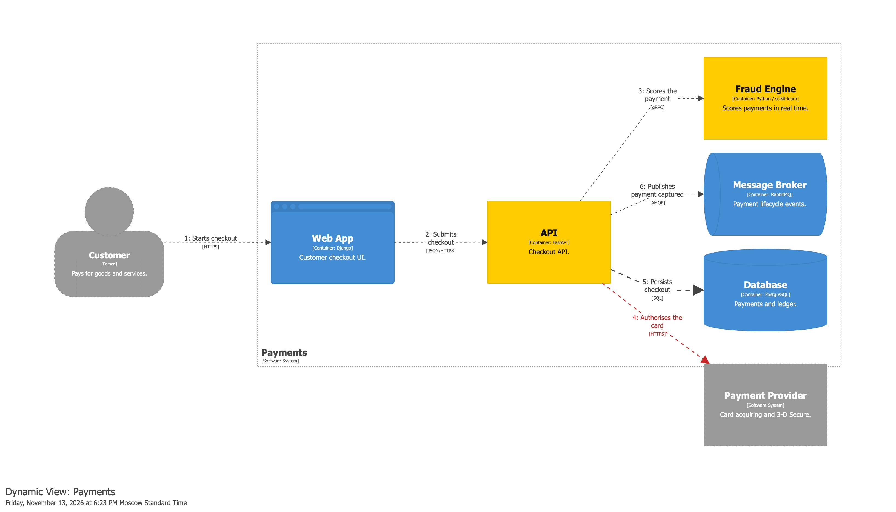
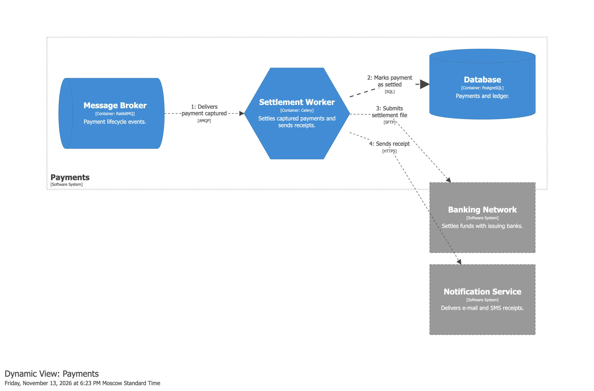

# Structurizr

Structurizr examples describe a whole `Workspace` (model, views and styles)
instead of one portable diagram, so they are not part of the
[common examples](../index.md). Each example is defined as JSON, converted to
Python with `c4 convert --json-to-py`, and rendered to Structurizr DSL with
`c4 render --structurizr`.

Images are produced by the official Structurizr CLI
(`structurizr export -w workspace.dsl -f png`), which renders every view of the
rendered DSL, so each view below has its own image. The same DSL can also be
exported through a Kroki server with `c4 export --structurizr`.

## Minimal workspace

A person, a software system, one relationship and a system landscape view.

<figure markdown="span">
  
  <figcaption>workspace.minimal.landscape.png (view <code>landscape</code>)</figcaption>
</figure>

??? abstract "JSON workspace"

    ```json
    --8<-- "assets/examples/json/structurizr/workspace.minimal.json"
    ```

??? abstract "Converted Python workspace"

    ```python
    --8<-- "assets/examples/structurizr/workspace.minimal.py"
    ```

??? abstract "Rendered Structurizr DSL"

    ```dsl
    --8<-- "assets/examples/structurizr/workspace.minimal.dsl"
    ```

<br/>

## Advanced workspace

A larger payments workspace: customers and staff, external systems (payment
provider, banking network, identity provider, notifications), nine containers
with an asynchronous settlement pipeline, components of the API, tag-based
styles, and two dynamic views.

=== "Landscape"

    <figure markdown="span">
      
      <figcaption>landscape</figcaption>
    </figure>

=== "System context"

    <figure markdown="span">
      
      <figcaption>context</figcaption>
    </figure>

=== "Containers"

    <figure markdown="span">
      
      <figcaption>containers</figcaption>
    </figure>

=== "Components"

    <figure markdown="span">
      
      <figcaption>components</figcaption>
    </figure>

=== "Checkout"

    <figure markdown="span">
      
      <figcaption>checkout-flow</figcaption>
    </figure>

=== "Settlement"

    <figure markdown="span">
      
      <figcaption>settlement-flow</figcaption>
    </figure>

??? abstract "JSON workspace"

    ```json
    --8<-- "assets/examples/json/structurizr/workspace.advanced.json"
    ```

??? abstract "Converted Python workspace"

    ```python
    --8<-- "assets/examples/structurizr/workspace.advanced.py"
    ```

??? abstract "Rendered Structurizr DSL"

    ```dsl
    --8<-- "assets/examples/structurizr/workspace.advanced.dsl"
    ```
