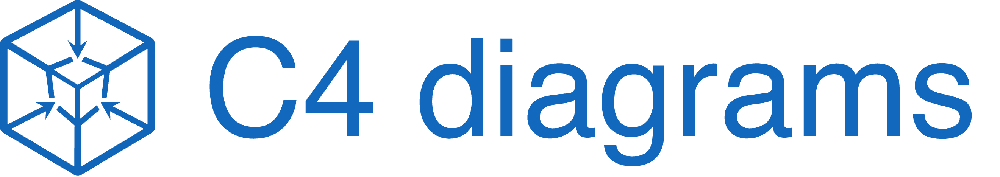
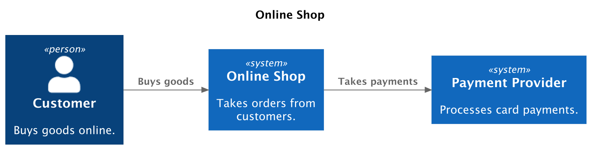
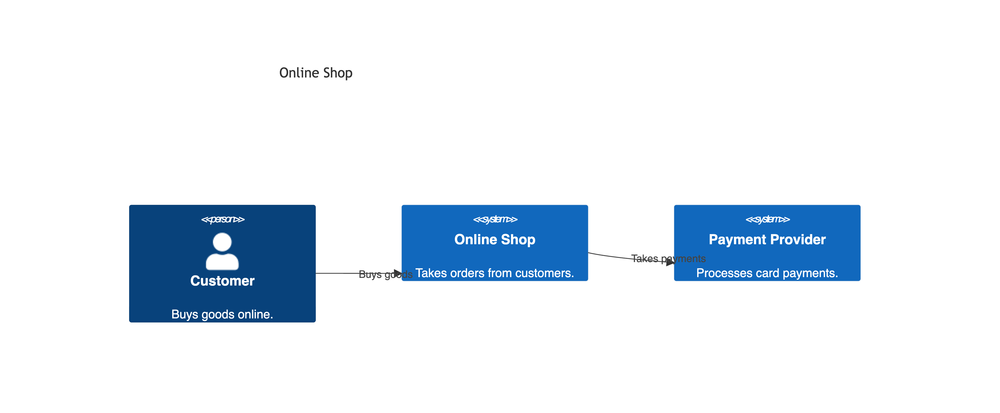
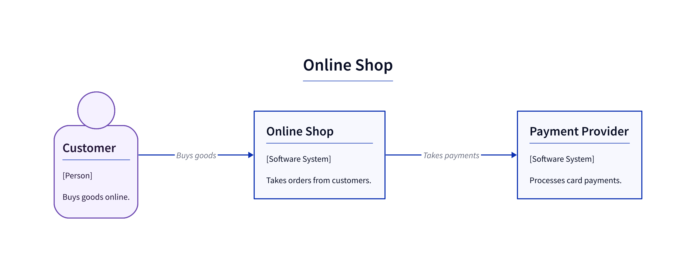
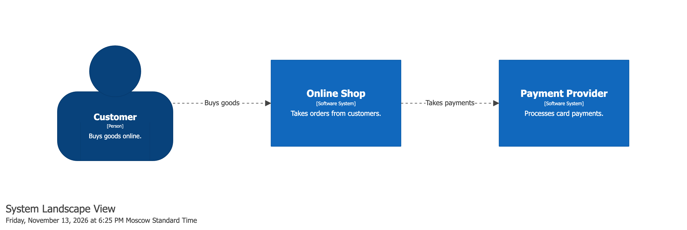
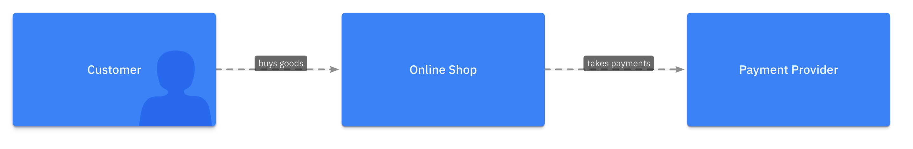

<figure markdown="span">
  
  <figcaption>A Python DSL for C4 model diagrams.</figcaption>
</figure>

# c4-diagrams

[](https://pypi.org/project/c4-diagrams/)
[](https://pypi.org/project/c4-diagrams/)
[](https://github.com/sidorov-as/c4-diagrams/actions/workflows/main.yml?query=branch%3Amain)
[](https://qlty.sh/gh/sidorov-as/projects/c4-diagrams)
[](https://qlty.sh/gh/sidorov-as/projects/c4-diagrams)
[](https://img.shields.io/github/license/sidorov-as/c4-diagrams)
[](https://deepwiki.com/sidorov-as/c4-diagrams)

**c4-diagrams** is a Python DSL for defining **[C4 model](https://c4model.com/) architecture diagrams as code**.

The package provides first-class abstractions for C4 entities — people, systems, containers, components, boundaries,
and relationships — allowing you to describe software architecture in Python and render it into multiple diagram formats.

## Features

- Declarative Python DSL for C4 modeling
- First-class C4 entities and relationships
- Multiple rendering backends
- Suitable for documentation, ADRs, and architecture reviews
- Portable core DSL for the common C4 subset, with backend-specific features available through contrib extensions

## Rendering backends

| Backend                                   | What you describe                                  | Formats                  | Docs                                      |
|-------------------------------------------|----------------------------------------------------|--------------------------|-------------------------------------------|
| [PlantUML](https://github.com/plantuml-stdlib/C4-PlantUML) | Portable diagram, rendered as C4-PlantUML          | PNG, SVG, EPS, LaTeX, TXT, UTXT | [PlantUML backend](renderers/plantuml/index.md) |
| [Mermaid](https://mermaid.ai/open-source/syntax/c4.html)   | Portable diagram, rendered as Mermaid C4 (experimental) | PNG, SVG, PDF       | [Mermaid backend](renderers/mermaid/index.md)   |
| [D2](https://d2lang.com/)                 | Portable diagram, rendered as D2                   | PNG, SVG, PDF            | [D2 backend](renderers/d2/index.md)             |
| [Structurizr](https://structurizr.com/)   | Structurizr `Workspace` (model, views, styles)     | PNG, SVG, PDF            | [Structurizr backend](renderers/structurizr/index.md) |
| [LikeC4](https://likec4.dev/)             | LikeC4 `Project` (specification, model, views)     | PNG, JPG                 | [LikeC4 backend](renderers/likec4/index.md)     |

For a side-by-side feature matrix, see the [comparison](renderers/comparison.md).

## Example

!!! note

    PlantUML, Mermaid and D2 render the same portable diagram (the PlantUML tab
    uses `RelRight` to lay it out left to right). Structurizr and LikeC4 describe their own object
    (a `Workspace` or a `Project`), so their DSL differs from the portable one.

Here is a **system context diagram** of an online shop, defined in Python and rendered with each backend:

=== "PlantUML"

    ```python
    --8<-- "assets/overview/overview.plantuml.py"
    ```

    The model is the same as in the portable code. The only difference is
    `RelRight` from `c4.contrib.plantuml` instead of `Rel`: PlantUML lays
    diagrams out top-down by default, and the portable model has no layout
    setting, so the direction is set per relationship.

    ```console
    c4 render overview.py --plantuml
    ```

    ??? abstract "Rendered PlantUML source"

        ```puml
        --8<-- "assets/overview/overview.puml"
        ```

    ```console
    c4 export overview.py --plantuml > diagram.png
    ```

    <figure markdown="span">
      
      <figcaption>diagram.png</figcaption>
    </figure>

    See the [PlantUML backend](renderers/plantuml/index.md).

=== "Mermaid"

    ```python
    --8<-- "assets/overview/overview.py"
    ```

    ```console
    c4 render overview.py --mermaid
    ```

    ??? abstract "Rendered Mermaid source"

        ```text
        --8<-- "assets/overview/overview.mmd"
        ```

    ```console
    c4 export overview.py --mermaid > diagram.png
    ```

    <figure markdown="span">
      
      <figcaption>diagram.png</figcaption>
    </figure>

    See the [Mermaid backend](renderers/mermaid/index.md).

=== "D2"

    ```python
    --8<-- "assets/overview/overview.py"
    ```

    ```console
    c4 render overview.py --d2
    ```

    ??? abstract "Rendered D2 source"

        ```text
        --8<-- "assets/overview/overview.d2"
        ```

    ```console
    c4 export overview.py --d2 > diagram.png
    ```

    <figure markdown="span">
      
      <figcaption>diagram.png</figcaption>
    </figure>

    See the [D2 backend](renderers/d2/index.md).

=== "Structurizr"

    ```python
    --8<-- "assets/overview/overview.workspace.py"
    ```

    ```console
    c4 render overview.py --structurizr
    ```

    ??? abstract "Rendered Structurizr DSL"

        ```text
        --8<-- "assets/overview/overview.workspace.dsl"
        ```

    ```console
    c4 export overview.py --structurizr --structurizr-view-key landscape > diagram.png
    ```

    <figure markdown="span">
      
      <figcaption>diagram.png</figcaption>
    </figure>

    See the [Structurizr backend](renderers/structurizr/index.md).

=== "LikeC4"

    ```python
    --8<-- "assets/overview/overview.project.py"
    ```

    ```console
    c4 render overview.py --likec4
    ```

    ??? abstract "Rendered LikeC4 source"

        ```text
        --8<-- "assets/overview/overview.project.c4"
        ```

    ```console
    c4 export overview.py --likec4 > diagram.png
    ```

    <figure markdown="span">
      
      <figcaption>diagram.png</figcaption>
    </figure>

    See the [LikeC4 backend](renderers/likec4/index.md).

More diagram types and backend-specific features are on the [Examples](examples/index.md) page.
